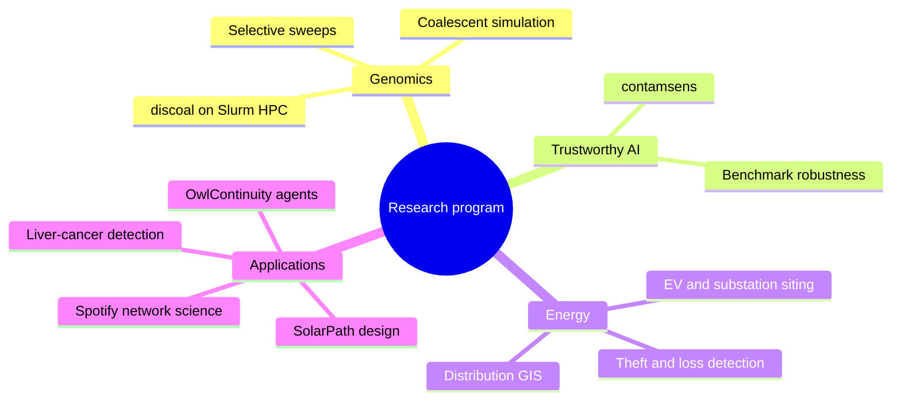
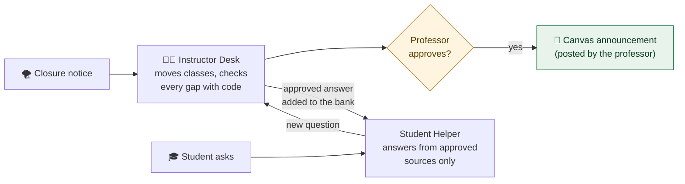
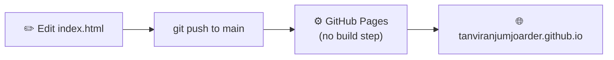

<div align="center">

<a href="https://tanviranjumjoarder.github.io/"></a>

[](https://tanviranjumjoarder.github.io/)
[](https://scholar.google.com/citations?user=fFcWmdwAAAAJ&hl=en)
[](https://orcid.org/0009-0005-3990-735X)
[](https://www.linkedin.com/in/tanvir-anjum-joarder)

**[🌐 Open the site](https://tanviranjumjoarder.github.io/)** · **[🧒 Explain it like I'm 5](#-explain-it-like-im-5)** · **[🎮 Things to play with](#-things-to-play-with-on-the-site)** · **[🦉 OwlContinuity](#-owlcontinuity)** · **[🛠️ How this repo works](#%EF%B8%8F-how-this-repo-works)**

</div>

---

## 🧒 Explain it like I'm 5


<details>
<summary><b>👩‍🎓 Now tell me like a grown-up</b> (click to open)</summary>
<br>

| | In one picture | What it really is |
|---|---|---|
| 🧬 | **Find clues in DNA** | Simulation-based deep learning for detecting natural selection, in the DeGiorgio Lab at Florida Atlantic University. Convolutional networks trained on large sets of coalescent simulations (made with discoal on an HPC cluster) learn to recognise selective sweeps in genomic data. |
| 📊 | **Check the scoreboards** | **contamsens**, a sensitivity analysis that asks how much hidden test-set contamination it would take to overturn a published ML benchmark claim. In a pre-registered audit of the Open LLM Leaderboard, 49 of 58 adjacent ranking claims (84.5%) were not contamination-robust. [Code →](https://github.com/tanviranjumjoarder/contamsens) |
| 💡 | **Keep the lights on** | Four years at the Bangladesh Rural Electrification Board: electricity-theft and system-loss screening, EV-charging and substation siting, and ArcGIS mapping of the 33/11 kV network. [GIS tool →](https://github.com/tanviranjumjoarder/GIS-Distribution-Line-Drawing) · [Consumer tracker →](https://github.com/tanviranjumjoarder/Low-usage-Industrial-Consumer-Tracker-App) |
| 🦉 | **Rescue a cancelled class** | **OwlContinuity**, three AI agents built at the AI Promptathon, FAU Hackathon 2026. [More below ↓](#-owlcontinuity) |

</details>

### How the pieces connect



---

## 🎮 Things to play with on the site

The website is a single page, and most of it moves. Tick these off as you try them:

- [ ] **Press `Ctrl K`** (or `/`) anywhere to search every section, project and paper.
- [ ] **[Drag the research graph](https://tanviranjumjoarder.github.io/#graph)**. Hover a node to see its methods, tools and projects.
- [ ] **[Spin the DNA helix](https://tanviranjumjoarder.github.io/#lab)**, then switch to selective sweeps, population trees and coalescent genealogies.
- [ ] **[Widen a selective sweep](https://tanviranjumjoarder.github.io/#xp-sweep)**. Slide selection strength and recombination rate and watch the diversity valley change.
- [ ] **[Ask "who is the most important node?"](https://tanviranjumjoarder.github.io/#xp-net)** and switch between degree, betweenness, closeness, eigenvector and PageRank.
- [ ] **[Filter the papers](https://tanviranjumjoarder.github.io/#publications)** and copy a citation or BibTeX.
- [ ] **[Open any project card](https://tanviranjumjoarder.github.io/#projects)** for methods and outcomes.
- [ ] **Flip light / dark mode** with the sun button at the top.

<details>
<summary><b>🧒 What is a "selective sweep", like I'm 5?</b></summary>
<br>

Imagine a class where one kid brings a really cool toy. Everyone who sits **near** that kid starts playing with the same toy, so that whole corner of the room looks the same. Kids sitting **far away** keep playing with different things.

DNA works a bit like that. When one helpful change spreads through a population, the DNA sitting right next to it gets carried along, and that stretch becomes "all the same" (a **valley of low diversity**). The computer models learn to spot those valleys.

</details>

---

## 🦉 OwlContinuity

<a href="https://tanviranjumjoarder.github.io/OwlContinuity/"></a>

**Three AI agents in FAU's owlONE platform (gpt-6-luna), built at the AI Promptathon during FAU Hackathon 2026.** When a class gets cancelled, they rebuild the schedule, check every deadline that depends on it with code, and answer students only from what the professor has approved.

[](https://tanviranjumjoarder.github.io/OwlContinuity/)
[](https://tanviranjumjoarder.github.io/OwlContinuity/how-it-works.html)
[](https://tanviranjumjoarder.github.io/OwlContinuity/#video)
[](https://github.com/tanviranjumjoarder/OwlContinuity)



<details>
<summary><b>🧒 Explain OwlContinuity like I'm 5</b></summary>
<br>

| | |
|---|---|
| 🌪️ **1. Storm** | A storm closes school. The teacher hands the helper robot the calendar, the rules and the storm news. |
| 🔍 **2. Find the hits** | The robot circles every class that lands on a closed day. |
| 💥 **3. Domino** | Moving the lab is like pushing the first domino. Now the homework is due too soon after it. |
| 🧮 **4. Count, don't guess** | The robot counts the hours with a calculator, moves the homework to Tuesday, keeps the big test where it is, and asks the teacher: "Is this OK?" |
| 🙋 **5. New question** | A student asks something the teacher never answered. The robot says "I don't know yet" and writes a note to the teacher. |
| 📚 **6. Answer once** | The teacher answers once. Every student after that gets the answer right away. |

</details>

<details>
<summary><b>📏 What was tested, and what it does not claim</b></summary>
<br>

- **Main tests:** 31 passed · 2 partial · 0 failed (33 checks).
- **Real FAU graduate syllabus:** 17 of 17 checks, two with noted differences, using simulated closures and test rules I set.
- These are my own recorded tests, not an independent validation. Every run is saved in the [OwlContinuity repo](https://github.com/tanviranjumjoarder/OwlContinuity).
- The AI agents run in owlONE, which needs an FAU account. The public demo replays the same workflows in plain JavaScript with no AI model.
- It is a prototype, not an official FAU system. Demo course data is fictional.

</details>

---

## 📚 Publications at a glance

<sub>Citation counts from [Google Scholar](https://scholar.google.com/citations?user=fFcWmdwAAAAJ&hl=en), 18 October 2026 · 5 papers · 107 citations · h-index 4 · i10-index 2</sub>

| Year | Paper | Venue | Cited |
|---|---|---|---:|
| 2025 | [A comprehensive review of carbon dioxide capture, transportation, utilization, and storage](https://doi.org/10.1007/s11356-025-36284-9) | Environ. Sci. Pollut. Res. (Q1) | 77 |
| 2021 | [Electricity generation from the rotational speed of train wheel](https://www.researchgate.net/publication/359928987) | ICMERE 2021 | 8 |
| 2019 | [Solution to air pollution for removing CO₂ and SO₂ from flue gases](https://www.researchgate.net/publication/346687530) | ICMERE 2019 | 15 |
| 2019 | [Safety at industrial working place by separating carbon dioxide gas](https://www.researchgate.net/publication/342752013) | ICMIME 2019 | 5 |
| 2019 | [Detecting liver cancer from online search logs](https://doi.org/10.1109/EICT48899.2019.9068842) · *first author* | IEEE EICT 2019 | 2 |

---

## 🛠️ How this repo works



<details>
<summary><b>📁 What's in the box</b></summary>
<br>

```
.
├── index.html          # the whole site: HTML + CSS + JS in one file
├── 404.html            # "page not found" page
├── README.md           # this file
└── assets/
    ├── Tanvir_Anjum_Joarder_CV.pdf
    ├── profile.jpg
    ├── papers/         # PDFs linked from the Publications section
    └── readme/         # animated pictures used in this README
```

</details>

<details>
<summary><b>💻 Preview it on your computer</b></summary>
<br>

Open `index.html` in a browser, or serve the folder so paths behave like the live site:

```bash
python3 -m http.server 8000
```

Then visit <http://localhost:8000>.

</details>

<details>
<summary><b>✏️ Change the content</b></summary>
<br>

Everything lives in `index.html`:

| To change… | Look for… |
|---|---|
| Hero numbers (citations, projects) | `data-count="…"` in the hero and Publications header |
| A paper's citation count | `data-cites="…"` on its `<article class="pub">`, plus the "N citations" badge |
| Project cards | `id="proj-grid"`, and the matching `'proj-…'` entry in the `DETAIL` object for the pop-up |
| Software list | `CONFIG.repos` near the start of the script |
| Research graph | the `N` (nodes) and `E` (edges) arrays |
| Awards | `class="award"` blocks in the Honors section |

</details>

---

<div align="center">

**📫 [tjoarder2026@fau.edu](mailto:tjoarder2026@fau.edu)** · [GitHub](https://github.com/tanviranjumjoarder) · [Scholar](https://scholar.google.com/citations?user=fFcWmdwAAAAJ&hl=en) · [LinkedIn](https://www.linkedin.com/in/tanvir-anjum-joarder)

<sub>© 2026 Tanvir Anjum Joarder</sub>

</div>
