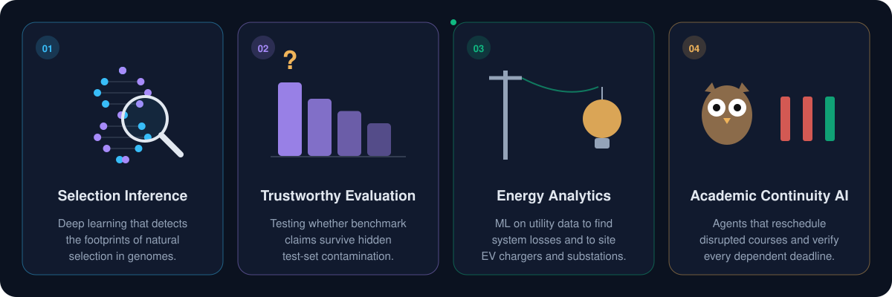
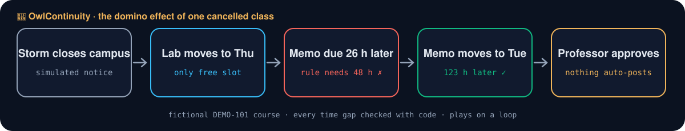
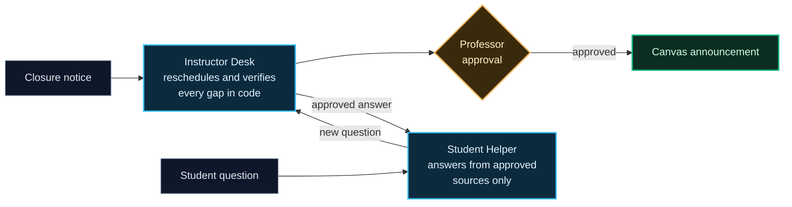
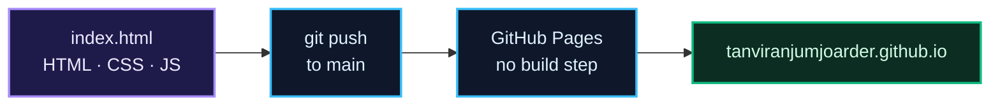

<div align="center">

<a href="https://tanviranjumjoarder.github.io/"></a>

[](https://tanviranjumjoarder.github.io/) [](https://scholar.google.com/citations?user=fFcWmdwAAAAJ&hl=en) [](https://orcid.org/0009-0005-3990-735X) [](https://www.linkedin.com/in/tanvir-anjum-joarder)

     

**[Research](#research-at-a-glance)** · **[Research map](#research-map)** · **[Interactive features](#interactive-features)** · **[OwlContinuity](#featured-project-owlcontinuity)** · **[Publications](#publications)** · **[Repository](#repository)**

</div>

<br>

PhD student in Computer Science at **Florida Atlantic University**, working in the **[DeGiorgio Lab](https://degiorgiogroup.fau.edu/)** on simulation-based deep learning for detecting natural selection. Before the PhD I spent four years leading machine-learning and GIS work at the **Bangladesh Rural Electrification Board**, a utility serving more than 80% of Bangladesh. This repository is the source of my research website: a single-page site with live, code-driven scientific visualizations.

## Research at a glance



<details>
<summary><b>Project details</b></summary>
<br>

| Thread | Focus | Status |
|---|---|---|
| **Selection Inference** | Convolutional networks trained on large coalescent-simulation datasets (discoal, Slurm HPC) to detect selective sweeps and estimate selection strength. | Doctoral research, [DeGiorgio Lab](https://degiorgiogroup.fau.edu/) |
| **Trustworthy Evaluation** | [contamsens](https://github.com/tanviranjumjoarder/contamsens): partial identification and sensitivity analysis for ML benchmark claims under unmeasured contamination. A pre-registered audit of the Open LLM Leaderboard found 49 of 58 adjacent ranking claims (84.5%) were not contamination-robust. | Manuscript complete |
| **Energy Analytics** | Electricity-theft and system-loss screening, EV-charging and substation siting, and distribution-network GIS. Open tools: [GIS line drawing](https://github.com/tanviranjumjoarder/GIS-Distribution-Line-Drawing) · [Low-usage consumer tracker](https://github.com/tanviranjumjoarder/Low-usage-Industrial-Consumer-Tracker-App) | In progress |
| **Academic Continuity AI** | [OwlContinuity](https://github.com/tanviranjumjoarder/OwlContinuity): owlONE agents that reschedule disrupted courses and verify dependent deadlines. | Prototype, FAU Hackathon 2026 |

</details>

## Research map

<a href="https://tanviranjumjoarder.github.io/#graph"></a>

<sub>Four threads built on shared machine-learning methods. Dashed links mark methods that cross threads. The <a href="https://tanviranjumjoarder.github.io/#graph">interactive version</a> on the website can be dragged and explored.</sub>

## Interactive features

The website is built to be explored, not just read. Every visualization is drawn live in the browser.

| | Feature | What it shows |
|:---:|---|---|
| 🧬 | **[Genomics visualization lab](https://tanviranjumjoarder.github.io/#lab)** | DNA helix, selective sweep, population tree, coalescent genealogy and haplotypes, each animated from code |
| 📈 | **[Selective-sweep explorer](https://tanviranjumjoarder.github.io/#xp-sweep)** | Adjust selection strength and recombination rate and watch the diversity valley respond (Maynard Smith &amp; Haigh hitchhiking approximation) |
| 🕸️ | **[Centrality explorer](https://tanviranjumjoarder.github.io/#xp-net)** | Compare degree, betweenness, closeness, eigenvector and PageRank on the same network |
| 🔗 | **[Research graph](https://tanviranjumjoarder.github.io/#graph)** | Draggable knowledge graph linking methods, tools, projects and papers |
| 📚 | **[Publications](https://tanviranjumjoarder.github.io/#publications)** | Search, filter and sort; copy a citation or BibTeX from any entry |
| ⌨️ | **Command palette** | Press <kbd>Ctrl</kbd> + <kbd>K</kbd> to jump to any section, project or paper |
| 🌗 | **Light and dark themes** | Full theme support, with reduced-motion respected |

<details>
<summary><b>Background: what is a selective sweep?</b></summary>
<br>

When a beneficial mutation spreads through a population, nearby neutral variants are carried along with it (genetic hitchhiking). Diversity drops in a valley around the selected site, and recombination sets how wide that valley is. These footprints are what the deep-learning models in my doctoral work are trained to recognise, using genomes simulated under known evolutionary histories.

</details>

## Featured project: OwlContinuity

<a href="https://tanviranjumjoarder.github.io/OwlContinuity/"></a>

Three AI agents in FAU's owlONE platform (gpt-6-luna), built at the AI Promptathon during FAU Hackathon 2026. When a class is cancelled, they rebuild the schedule, verify every dependent deadline in code, and answer students only from professor-approved sources.

[](https://tanviranjumjoarder.github.io/OwlContinuity/) [](https://tanviranjumjoarder.github.io/OwlContinuity/how-it-works.html) [](https://tanviranjumjoarder.github.io/OwlContinuity/#video) [](https://github.com/tanviranjumjoarder/OwlContinuity)



<details>
<summary><b>Workflow, step by step</b></summary>
<br>

| Step | What happens |
|---|---|
| **1 · Intake** | Instructor Desk reads the closure notice, syllabus and the professor's scheduling rules. |
| **2 · Impact** | It identifies every class session and activity that falls on a closed day. |
| **3 · Cascade** | It reschedules into the available make-up slots and traces deadlines that depend on moved sessions. In the demo, the lab moves to Thursday and the memo would be due only 26 h 10 m later against a 48-hour rule. |
| **4 · Verify** | Time gaps are computed in code (`America/New_York` → UTC, so clock changes count). The memo moves to Tuesday, 123 h 10 m later, and the final stays fixed. Everything is a draft for the professor. |
| **5 · Escalate** | When a student asks something not yet covered, Student Helper does not guess; it drafts a message to the professor. |
| **6 · Reuse** | The professor answers once, approves it into the answer bank, and every later student receives it. |

</details>

<details>
<summary><b>Evaluation and scope</b></summary>
<br>

- **Main test report:** 31 passed · 2 partial · 0 failed (33 checks)
- **Real FAU graduate syllabus:** 17 / 17 checks, two with noted differences, using simulated closures and test rules
- Results are from my own recorded tests rather than an independent evaluation; every run is saved in the [repository](https://github.com/tanviranjumjoarder/OwlContinuity).
- The agents run in owlONE, which requires an FAU account. The public demo replays the same workflows in JavaScript without an AI model.
- A prototype, not an official FAU system. Demo course data is fictional.

</details>

## Publications

<sub>Google Scholar, 20 October 2026 · **5** papers · **107** citations · h-index **4** · i10-index **2**</sub>

| Year | Paper | Venue | Citations |
|:---:|---|---|:---:|
| 2025 | [A comprehensive review of carbon dioxide capture, transportation, utilization, and storage: a source of future energy](https://doi.org/10.1007/s11356-025-36284-9) | *Environmental Science and Pollution Research* (Q1) | **77** |
| 2021 | [Electricity generation from the rotational speed of train wheel: an approach of future energy](https://www.researchgate.net/publication/359928987) | ICMERE 2021 | 8 |
| 2019 | [Solution to air pollution for removing CO₂ and SO₂ from flue gases: a prospective approach](https://www.researchgate.net/publication/346687530) | ICMERE 2019 | 15 |
| 2019 | [Safety at industrial working place by separating carbon dioxide gas](https://www.researchgate.net/publication/342752013) | ICMIME 2019 | 5 |
| 2019 | [Detecting liver cancer from online search logs](https://doi.org/10.1109/EICT48899.2019.9068842) · first author | IEEE EICT 2019 | 2 |

## Repository



<details>
<summary><b>Structure</b></summary>
<br>

```
.
├── index.html          # the complete site: markup, styles and scripts in one file
├── 404.html            # not-found page
├── README.md
└── assets/
    ├── Tanvir_Anjum_Joarder_CV.pdf
    ├── profile.jpg
    ├── papers/         # PDFs linked from the Publications section
    └── readme/         # animated SVG graphics used in this README
```

</details>

<details>
<summary><b>Run locally</b></summary>
<br>

```bash
python3 -m http.server 8000
```

Then open <http://localhost:8000>. Opening `index.html` directly also works.

</details>

<details>
<summary><b>Updating content</b></summary>
<br>

| To update | Edit in `index.html` |
|---|---|
| Headline metrics | `data-count="…"` in the hero and the Publications header |
| A paper's citation count | `data-cites="…"` on its `<article class="pub">` and the citation badge |
| Project cards | `#proj-grid`, plus the matching `'proj-…'` entry in `DETAIL` for its detail view |
| Software list | `CONFIG.repos` |
| Research graph | the `N` (nodes) and `E` (edges) arrays |
| Honors | the `.award` blocks |

</details>

<br>

<div align="center">

**[tjoarder2026@fau.edu](mailto:tjoarder2026@fau.edu)** · [Website](https://tanviranjumjoarder.github.io/) · [Google Scholar](https://scholar.google.com/citations?user=fFcWmdwAAAAJ&hl=en) · [ORCID](https://orcid.org/0009-0005-3990-735X) · [LinkedIn](https://www.linkedin.com/in/tanvir-anjum-joarder) · [DeGiorgio Lab](https://degiorgiogroup.fau.edu/)

<sub>© 2026 Tanvir Anjum Joarder</sub>

</div>
